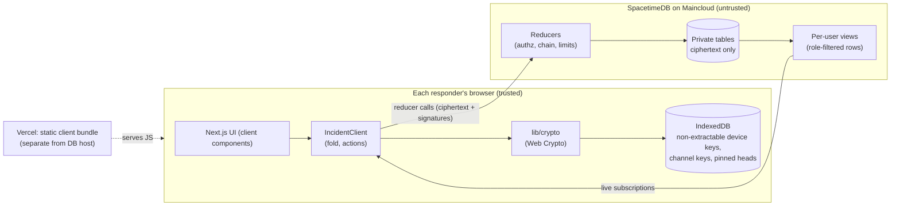

# ZeroHour build plan (for coding agents)

This file is the technical source of truth for building ZeroHour at HackUTD 2026 (Nov 7 to 8). Humans read the summary doc; agents read this. If something here conflicts with your training data about Spacetime or Next.js, this file and the installed package sources win. If something here conflicts with `docs/THREAT_MODEL.md`, stop and ask a human.

**How to use it:** find your step card in section 10, read sections 3 to 6 for the contracts it touches, do the work, run the checks in section 12, then update the status column in `docs/THREAT_MODEL.md` for any mitigation you implemented.

---

## 1. What we are building

ZeroHour is an end-to-end encrypted, tamper-evident command center for the first 72 hours of a ransomware incident. Responders (the client's IT lead, outside counsel, forensics, executives) join from laptops and phones and share one live picture: what is hit, what data was exposed, who is doing what, and which legal notification deadlines are running.

**Design assumption (Winstead's rule):** the attacker controls the network and has full access to our server and database. So:

- The server stores **structure, never content**: ids, roles, timestamps, sizes. All human-written content is encrypted and signed in the browser.
- The server enforces roles (defense in depth), but **every client independently verifies** signatures, the roster, and the hash chain, and shows a red alarm on any failure.
- History is **append-only**. Nothing is edited or deleted; corrections are new entries that reference the old one.

**Targets:** Winstead Cyber Incident Response ($1,500), Build on Spacetime ($2,048, "majority of backend on Spacetime"), Best Design, General ($20k).

**Winstead requirements and where they land:**

| Requirement | Feature |
| --- | --- |
| Secure, runs isolated inside a possibly compromised network | E2EE + signatures + client verification; self-hostable Spacetime |
| Admin access control to add users | Commander invites with role, admits after verification, revokes |
| Standards-based incident documentation, real-time updates and status | #record channel: timeline with NIST SP 800-61 phases and CSF 2.0 categories, status header, after-action report |
| Scope of compromised data and its status | Blast-radius board (scope items) |
| Real-time communications | Encrypted channels over Spacetime subscriptions |

---

## 2. Schedule and lanes

All times US Central, Sat Nov 7 to Sun Nov 8. Hacking ends 12:00 pm Sunday; submit by 11:30 am. Devpost team registration is due 11:00 pm Saturday.

- **Lane A (trust core):** Spacetime module, crypto library, real data client, revoke and rekey, hardening.
- **Lane B (product):** UI on a mock client, legal engine, join/admit/integrity screens, report, docs, video.
- **Sync 1 (3:45 to 4:15 pm):** contract frozen (sections 4, 6.1, `spacetimedb/src/shared/*`, `lib/protocol/*`).
- **Gate 1 (3:45 pm):** Spacetime live sync between two browsers on Maincloud.
- **Sync 2 / Gate 2 (9:00 pm):** mock client swapped for the real one; encrypted message end to end; `spacetime sql` shows ciphertext.
- **Run-through (11:00 pm):** P0 frozen.
- **Code freeze (10:00 am):** bug fixes only.

Priorities: **P0** must ship, **P1** should ship, **P2** stretch. Never start P1 work while a P0 item in your lane is open.

---

## 3. Architecture



### Repo layout

```
/                         Next.js 16 app (already scaffolded)
  app/                    routes (all incident screens are client components)
  components/             UI components
  lib/
    crypto/               keys, seal/open, sign/verify, wrap/unwrap, invite, fingerprint, chain verify
    protocol/             zod schemas for event payloads, kinds, per-kind policy, types
    client/               IncidentClient interface, fold, MockIncidentClient, RealIncidentClient
    legal/                deadline rules engine + business-day calendar
    report/               after-action report builder
    scenario/             seeded demo scenario for the mock
  spacetimedb/            Spacetime module (own package.json, tsconfig)
    src/index.ts          schema, tables, reducers, views, lifecycle, scheduled
    src/shared/           pure TS with ZERO imports, used by module AND client:
      policy.ts           roles, channels, canRead/canWrite matrix
      encoding.ts         canonical encoding, domain tags, statement builders
      limits.ts           size caps, ttl caps, rate limits
  src/module_bindings/    generated by `spacetime generate` (commit it)
  tests/e2e/              Playwright
  docs/                   PLAN.md, THREAT_MODEL.md, DEVPOST.md
```

### Environment and commands

- Node 22+ (Spacetime requires it). Spacetime CLI installed; `spacetime login` for Maincloud.
- Local Spacetime listens on port 3000, so run Next on **3001**: change the `dev` script to `next dev -p 3001`.
- Env (public, not secret): `NEXT_PUBLIC_SPACETIMEDB_HOST` (default `wss://maincloud.spacetimedb.com`), `NEXT_PUBLIC_SPACETIMEDB_DB_NAME` (e.g. `zerohour-hackutd26`, must be globally unique on Maincloud). Put them in `.env.local` (gitignored) and in Vercel project settings.
- Add these npm scripts:
  - `"spacetime:publish": "spacetime publish --module-path spacetimedb --server maincloud $NEXT_PUBLIC_SPACETIMEDB_DB_NAME"` (or hard-code the db name)
  - `"spacetime:generate": "spacetime generate --lang typescript --out-dir src/module_bindings --module-path spacetimedb"`
  - `"typecheck": "tsc --noEmit && tsc -p spacetimedb --noEmit"`
  - `"test": "vitest run"`, `"test:e2e": "playwright test"`
- Root `tsconfig.json`: add `"spacetimedb"` to `exclude` (the module has its own tsconfig; files under `spacetimedb/src/shared/` are still type-checked when the client imports them).
- Republish after every module change, then regenerate bindings. Changing a table's columns on Maincloud may require `spacetime publish --delete-data` (wipes the demo DB; that is fine before the final reset, never after 10:00 am without telling the humans).

### Allowed dependencies

`spacetimedb` (2.14.x), `zod`, `@noble/hashes`, `@noble/curves`, `idb-keyval`, `qrcode` (or `qrcode.react`), dev: `vitest`, `fake-indexeddb`, `@playwright/test`. Anything else needs a human yes. No other crypto libraries. No UI kit that injects raw HTML.

---

## 4. Contract (frozen at Sync 1)

Shared code lives in `spacetimedb/src/shared/` (imported by the module and by the client via `@/spacetimedb/src/shared/...`) and `lib/protocol/` (client only). These files must not import anything.

### 4.1 Roles, channels, policy

```ts
export const ROLES = ['commander', 'counsel', 'technical', 'executive'] as const;
export type Role = (typeof ROLES)[number];
export const CHANNELS = ['record', 'command', 'privileged', 'technical'] as const;
export type ChannelKind = (typeof CHANNELS)[number];

// who can decrypt (and receive rows of) each channel
export const READ: Record<ChannelKind, readonly Role[]> = {
  record:     ['commander', 'counsel', 'technical', 'executive'],
  command:    ['commander', 'counsel', 'technical', 'executive'],
  privileged: ['commander', 'counsel', 'executive'],
  technical:  ['commander', 'counsel', 'technical'],
};
// who can append to each channel
export const WRITE: Record<ChannelKind, readonly Role[]> = {
  record:     ['commander', 'counsel', 'technical'],
  command:    ['commander', 'counsel', 'technical', 'executive'],
  privileged: ['commander', 'counsel', 'executive'],
  technical:  ['commander', 'counsel', 'technical'],
};
export const canRead = (r: Role, c: ChannelKind) => READ[c].includes(r);
export const canWrite = (r: Role, c: ChannelKind) => WRITE[c].includes(r);
export const INVITABLE_ROLES: readonly Role[] = ['counsel', 'technical', 'executive'];
```

Only the incident creator is `commander` (single root of trust in v1; a second commander is P2).

### 4.2 Encoding

- Bytes on the wire and in tables: `t.byteArray()` (Uint8Array). In URLs: base64url without padding.
- Identities in signed statements: `identity.toHexString()` (lowercase hex).
- Ids generated by clients: incident ids, event ids, entry/item/task ids are UUIDv4 strings from `crypto.randomUUID()`. The module validates the format.
- **Canonical encoding** (`encoding.ts`), used for every signature, AAD, HMAC, hash and KDF input:
  `enc(...fields)` = concatenation of `u32be(len(f)) || f` for each field, where strings are UTF-8, `bigint`/integers are 8-byte big-endian unsigned, and `Uint8Array` is raw. The **first field is always a domain tag** (below). Never sign or hash JSON.
- Domain tags (constants in `encoding.ts`):
  `zh1/event-aad`, `zh1/event-sig`, `zh1/chain`, `zh1/genesis`, `zh1/wrap-salt`, `zh1/wrap`, `zh1/invite`, `zh1/join`, `zh1/admit`, `zh1/revoke`, `zh1/checkpoint`, `zh1/fp`, `zh1/safety`.

### 4.3 Device keys, fingerprints, safety codes

- On first use per incident, the browser generates two key pairs with Web Crypto, **private keys non-extractable**:
  - signing: `ECDSA` `P-256` (signatures with `{ name: 'ECDSA', hash: 'SHA-256' }`, 64-byte r||s)
  - key agreement: `ECDH` `P-256`
- Public keys exported as `raw` (65-byte uncompressed points). Private `CryptoKey` objects are stored in IndexedDB (structured clone) keyed by `incidentId`. Never export them.
- **Fingerprint** of a member: `SHA-256(enc('zh1/fp', signPub, ecdhPub))`, shown as 8 groups of 4 hex chars; the commander's full fingerprint travels in invite links.
- **Safety code** (read aloud during admission): `n = first 5 bytes of SHA-256(enc('zh1/safety', incidentId, identityHex, signPub, ecdhPub))` as a big-endian integer, `n mod 10^12`, zero-padded, shown as `123 456 789 012`. Both the joiner's screen and the commander's admit card compute it locally.

### 4.4 Invite and join protocol

1. **Commander creates an invite** (browser): `code = 16 random bytes`, `secret = 32 random bytes` (both `crypto.getRandomValues`). `codeHash = SHA-256(enc('zh1/invite', incidentId, code))`. Call `create_invite({ incidentId, codeHash, role, ttlMinutes })`. Store `{ codeHash, secret, role }` in the commander's IndexedDB. Build the link:
   `https://<app>/join#i=<incidentId>&c=<b64url code>&s=<b64url secret>&f=<b64url commander fingerprint>&r=<role>`
   The fragment is never sent to any server (not in requests, logs or Referer). Show it as a QR code and a copy button.
2. **Joiner opens the link:** read the fragment, then immediately `history.replaceState(null, '', '/join')` so the secret leaves the address bar and history. Generate device keys. Compute `joinTag = HMAC-SHA256(key = secret, enc('zh1/join', incidentId, myIdentityHex, displayName, signPub, ecdhPub))`. Call `redeem_invite({ incidentId, code, displayName, signPub, ecdhPub, joinTag })`. **Never send `secret`.**
3. **Module** checks the invite (section 5.2) and inserts a `pending` member.
4. **Joiner** verifies the commander: once the incident row arrives, recompute the commander fingerprint from `incident.commanderSignPub/EcdhPub` and compare with `f` from the link. Mismatch = hard stop with a red "this is not the incident you were invited to" screen. Pin the commander keys in IndexedDB. Show own safety code and "waiting for the commander".
5. **Commander's client** sees the pending member, looks up the invite secret by the member's `inviteCodeHash`, recomputes `joinTag` and shows **"Link verified"** (green) or **"Unverified: do not admit"** (red). It also shows the safety code. The commander confirms the code by voice, then clicks Admit.

### 4.5 Admission and revocation statements

- Admission certificate (signed by the commander's signing key):
  `admitSig = sign(enc('zh1/admit', incidentId, memberIdentityHex, role, displayName, signPub, ecdhPub))`
  The commander self-signs its own certificate at `create_incident`.
- Revocation: `revokeSig = sign(enc('zh1/revoke', incidentId, memberIdentityHex))`.
- Clients only trust a member's events if the member row carries a valid `admitSig` under the **pinned** commander key. Events from a member after their revocation (by server timestamp order) are invalid.
- The commander also appends `roster.admit` / `roster.revoke` events to #record so roster changes are inside the tamper-evident log.

### 4.6 Channel keys, epochs, wrapping

- Each `(incidentId, channel kind, epoch)` has one AES-256-GCM key, generated by the commander's browser. Epoch starts at 0 and increments on every rotation.
- **Wrapping for a recipient** (commander side):
  `shared = ECDH(commanderEcdhPriv, recipientEcdhPub)` (256 bits) then
  `kek = HKDF-SHA256(ikm = shared, salt = enc('zh1/wrap-salt', incidentId), info = enc('zh1/wrap', incidentId, kind, epoch, recipientIdentityHex))` as an AES-GCM-256 key, then
  `wrapped = AES-GCM(kek, iv = 12 random bytes, plaintext = raw channel key (32 bytes), aad = info)`.
  Store `{ incidentId, kind, epoch, recipient, wrapped (48 bytes), iv }` via a reducer.
- **Unwrapping** (recipient): same with `ECDH(myEcdhPriv, pinnedCommanderEcdhPub)`. Import the channel key as non-extractable AES-GCM for use. The commander re-derives raw bytes from its own envelope when it needs to re-wrap.
- **New member:** the commander wraps every epoch `0..current` of every channel the role can read (full history access).
- **Revocation:** for every channel the revoked member could read, the commander generates a new epoch key, wraps it for every remaining active member who can read that channel, and submits all of it atomically with `revoke_member`. After that, appends in older epochs are rejected by the module and flagged by clients.

### 4.7 Event envelope

Plaintext payload (UTF-8 JSON, zod-validated, max 12 KB before encryption): `{ v: 1, kind, sentAt: ISO string, body }`.

- `aad = enc('zh1/event-aad', incidentId, channelKind, epoch, authorIdentityHex, clientEventId, authorCounter)`
- `ciphertext = AES-GCM(channelKey[epoch], iv = 12 random bytes, plaintext, aad)` (Web Crypto appends the 16-byte tag)
- `sigInput = enc('zh1/event-sig', incidentId, channelKind, epoch, authorIdentityHex, clientEventId, authorCounter, iv, ciphertext)`
- `signature = ECDSA-P256-SHA256(authorSignPriv, sigInput)` (64 bytes)
- Sent to `append_event`. The module assigns `seq` (per channel, starting at 1) and `serverTs`, then:
  `hash = SHA-256(enc('zh1/chain', prevHash, seq, incidentId, channelKind, epoch, authorIdentityHex, clientEventId, authorCounter, iv, ciphertext, signature, serverTsMicros))`
  with `prevHash` for seq 1 = `SHA-256(enc('zh1/genesis', incidentId, channelKind))`.
- `authorCounter` is per author per incident, strictly increasing across all channels, starting at 1. The module stores the last value on the member row.

### 4.8 Payload kinds

Defined with zod in `lib/protocol/events.ts`. Every string has a max length; arrays have max sizes. Unknown kinds are **flagged, not dropped**.

Enums:

- `Phase`: `preparation | detection_analysis | containment | eradication | recovery | post_incident` (NIST SP 800-61 lifecycle)
- `Csf`: `DE.AE | RS.MA | RS.AN | RS.CO | RS.MI | RC.RP | RC.CO` (NIST CSF 2.0 categories used by SP 800-61 Rev. 3)
- `Severity`: `SEV1 | SEV2 | SEV3 | SEV4`
- `ScopeStatus`: `unknown | suspected | encrypted | exfiltrated | contained | eradicated | restored`
- `DataType`: `ssn | drivers_license | financial_account | payment_card | phi | credentials | biometric | employee_hr | privileged_legal | trade_secret | other_pii`

| kind | channel | allowed author roles | body |
| --- | --- | --- | --- |
| `incident.title` | record | commander | `{ title (1..120) }` |
| `status.set` | record | commander | `{ severity, phase, summary (0..500) }` |
| `timeline.add` | record | commander, counsel, technical | `{ entryId, occurredAt, phase, csf, text (1..4000), amends?: entryId }` |
| `scope.set` | record | commander, counsel, technical | `{ itemId, system (1..120), assetType: endpoint\|server\|database\|saas\|backup\|network\|other, status, dataTypes[], recordCount?, affected: { state: /^[A-Z]{2}$/, count }[] (max 60), euResidents?: count, notes (0..2000) }` |
| `task.set` | record | commander, counsel, technical | `{ taskId, title (1..200), assignee?: identityHex, dueAt?, status: open\|in_progress\|done\|blocked }` |
| `profile.set` | record | commander, counsel | `{ publicCompany, hipaaCoveredEntity, nydfsRegulated, defenseContractor, bank, euDataSubjects }` (booleans) |
| `legal.discovery` | record | commander, counsel | `{ determinedAt, basis (0..1000) }` |
| `legal.materiality` | record | commander, counsel | `{ determinedAt, basis (0..1000) }` |
| `deadline.update` | record | commander, counsel | `{ ruleId, status: open\|in_progress\|done\|not_applicable, owner?: identityHex, note (0..1000) }` |
| `evidence.add` | record | commander, counsel, technical | `{ evidenceId, label (1..200), sha256 (64 hex), location (0..300), custodian (0..120) }` |
| `roster.admit` | record | commander | `{ memberIdentity, role, displayName }` |
| `roster.revoke` | record | commander | `{ memberIdentity, reason (0..500) }` |
| `chat.post` | command, privileged, technical | anyone with write on that channel | `{ messageId, text (1..4000), mentions: identityHex[] (max 20), replyTo?: messageId }` |

Latest-wins items (`scope.set`, `task.set`, `profile.set`, `status.set`, `deadline.update`) fold by id in `seq` order; history stays visible ("changed by X at T").

### 4.9 Client verification algorithm (`lib/crypto/verify.ts`)

For each channel, process events in `seq` order and record a per-event verdict. Never silently drop a failing event; mark it and turn the integrity bar red.

1. `seq` is exactly previous + 1 (else: **gap**).
2. `prevHash` equals the previous event's hash (genesis for seq 1), and recomputing `hash` matches (else: **chain broken at seq N**).
3. Author is a member with a valid `admitSig` under the pinned commander key, and was not revoked before this event (else: **unknown or revoked author**).
4. `signature` verifies over `sigInput` with the author's `signPub` (else: **bad signature**).
5. Decrypts with the channel key for `epoch` and the recomputed `aad` (else: **cannot decrypt**: either a missing key, shown as "waiting for keys", or tampering).
6. Payload parses with zod, `kind` is valid for this channel and allowed for the author's role (else: **invalid payload** / **not permitted**).
7. `clientEventId` unique in the incident; `authorCounter` strictly greater than this author's previous counter (else: **replay**).
8. After the pass, compare with the **pinned head** in IndexedDB (`{ seq, hash }` per channel): the event at the pinned `seq` must still have the pinned hash (else: **history rewritten or rolled back**). Then pin the new head.
9. `sentAt` vs `serverTs` drift over 5 minutes is shown as a warning, not a failure.

Run it on initial load, on every inserted or updated row, and on demand from the integrity panel. Row updates or deletes on the events view are themselves suspicious (the module never updates or deletes events): re-verify and alarm.

### 4.10 Checkpoints (P1)

Every 10 events per channel or every 5 minutes, the commander's client signs `enc('zh1/checkpoint', incidentId, kind, seq, hash)` and calls `post_checkpoint`. Clients verify checkpoint signatures and that the chain at `seq` matches. The report prints the latest checkpoint per channel.

---

## 5. Spacetime module spec (`spacetimedb/src/index.ts`)

API reminders (spacetimedb 2.14, verified against the package source):

```ts
import { schema, table, t, SenderError } from 'spacetimedb/server';
import { ScheduleAt } from 'spacetimedb/server';
import { Timestamp } from 'spacetimedb'; // root export; or store expiries as u64 micros
const spacetimedb = schema({ incident, member, /* ...every table */ });
export default spacetimedb;
export const create_invite = spacetimedb.reducer({ incidentId: t.string(), /* ... */ }, (ctx, args) => { /* ... */ });
export const my_events = spacetimedb.view({ name: 'my_events', public: true }, t.array(event.rowType), (ctx) => { /* ctx.sender, ctx.db */ });
export const onConnect = spacetimedb.clientConnected((ctx) => { /* ... */ });
export const sweep_invites = spacetimedb.reducer({ name: 'sweep_invites', onSchedule: inviteSweep }, { arg: inviteSweep.rowType }, (ctx, { arg }) => { /* ... */ });
```

Context: `ctx.sender` (Identity), `ctx.timestamp` (Timestamp, `.microsSinceUnixEpoch` is a bigint), `ctx.db`, `ctx.senderAuth.isInternal`, `ctx.newUuidV4()`, `ctx.random` (**seeded, not cryptographic**). Column types: `t.string() t.bool() t.u32() t.u64() t.identity() t.timestamp() t.byteArray() t.scheduleAt()`, modifiers `.primaryKey() .autoInc() .unique() .index('btree')`. Confirm exact signatures in `node_modules/spacetimedb/src/server/schema.ts` and `src/lib/table.ts` if the compiler complains; do not guess from older 1.x examples.

**Gotchas that matter for security:**

- A reducer that throws (including `SenderError`) **rolls back all of its writes**. A rate-limit or failed-attempt counter written in a failing reducer does not persist. Record failed invite attempts and return normally instead of throwing (section 5.2).
- Scheduled reducers are callable by clients unless guarded. First line of every scheduled reducer: `if (!ctx.senderAuth.isInternal) throw new SenderError('forbidden');`
- Never generate keys, codes or nonces in the module. `ctx.random` is derived from the timestamp.
- The module has no Web Crypto. Use `@noble/hashes` (SHA-256) and `@noble/curves` (P-256 verify). Check the installed version's import paths (v2 uses `.js` suffixes, e.g. `@noble/hashes/sha2.js`).
- Module logs (`console.log`) are readable by the database owner: log ids and reasons only, never payload bytes.
- All tables are private (omit `public`). Only views are `public: true`.

### 5.1 Tables

| table | columns | notes |
| --- | --- | --- |
| `incident` | `id: string (pk, uuid)`, `commander: identity (index)`, `commanderSignPub: bytes(65)`, `commanderEcdhPub: bytes(65)`, `createdAt: timestamp`, `closed: bool` | |
| `member` | `id: u64 (pk, autoInc)`, `incidentId: string (index)`, `identity: identity (index)`, `role: string`, `state: string ('pending'\|'active'\|'revoked')`, `displayName: string`, `signPub: bytes(65)`, `ecdhPub: bytes(65)`, `joinTag: bytes(32)`, `inviteCodeHash: string (lowercase hex; empty for the commander)`, `admitSig: bytes(0 or 64)`, `revokeSig: bytes(0 or 64)`, `lastCounter: u64`, `joinedAt`, `admittedAt?`, `revokedAt?` (timestamps; use `t.option` or a zero sentinel) | one row per identity per incident |
| `invite` | `id: u64 (pk, autoInc)`, `incidentId: string (index)`, `codeHash: string, lowercase hex of the 32-byte hash (unique; byte arrays are not indexable)`, `role: string`, `createdBy: identity`, `expiresAt: timestamp`, `used: bool`, `usedBy: identity` (the creator until used), `usedAt: timestamp` | the code itself is never stored |
| `channel` | `id: u64 (pk, autoInc)`, `incidentId: string (index)`, `kind: string`, `currentEpoch: u32`, `headSeq: u64`, `headHash: bytes(32)` | 4 per incident, created with the incident |
| `key_envelope` | `id: u64 (pk, autoInc)`, `incidentId: string (index)`, `kind: string`, `epoch: u32`, `recipient: identity (index)`, `wrapped: bytes(48)`, `iv: bytes(12)`, `createdAt` | |
| `event` | `id: u64 (pk, autoInc)`, `channelId: u64 (index)`, `incidentId: string`, `kind: string` (channel kind, NOT the payload kind), `seq: u64`, `epoch: u32`, `author: identity`, `clientEventId: string (unique)`, `authorCounter: u64`, `iv: bytes(12)`, `ciphertext: bytes`, `signature: bytes(64)`, `serverTs: timestamp`, `prevHash: bytes(32)`, `hash: bytes(32)` | append-only: no reducer updates or deletes it |
| `checkpoint` (P1) | `id`, `incidentId`, `kind`, `seq`, `hash`, `signature`, `createdAt` | |
| `presence` (P1) | `identity (pk)`, `online: bool`, `lastSeen` | |
| `rate_bucket` (P1) | `key: string (pk)` (e.g. `append:<identityHex>`), `tokens: u32`, `updatedAt` | |
| `join_attempt` | `id`, `identity (index)`, `incidentId`, `at`, `ok: bool` | failed redeems recorded without throwing |
| `invite_sweep` (P1) | `scheduledId: u64 (pk, autoInc)`, `scheduledAt: scheduleAt` | inserted by `init` with `ScheduleAt.interval(5 min in micros)` |

### 5.2 Reducers

Every reducer: validate every argument's type, length and format first (use `limits.ts`), then authorization, then effects. Error messages are short and generic (`'not authorized'`, `'invalid request'`), never revealing whether another incident or member exists. Helper: `activeMember(ctx, incidentId)` returns the caller's active member row or throws.

| reducer | who | checks | effects |
| --- | --- | --- | --- |
| `create_incident({ incidentId, signPub, ecdhPub, displayName, admitSig, envelopes: { kind, wrapped, iv }[] })` | any identity (max 5 incidents per identity) | uuid format, unique id, key lengths 65, sig 64, displayName valid (section 5.5), exactly one envelope per channel kind | insert incident, commander member (`active`, self-signed `admitSig`), 4 channels (epoch 0, headSeq 0, headHash = genesis), 4 envelopes (epoch 0, recipient = sender) |
| `create_invite({ incidentId, codeHash, role, ttlMinutes })` | active commander | role in `INVITABLE_ROLES`, ttl 1..60, codeHash 32 bytes, at most 20 unused unexpired invites | insert invite with `expiresAt = now + ttl` |
| `redeem_invite({ incidentId, code, displayName, signPub, ecdhPub, joinTag })` | any identity | at most 5 attempts per identity per 10 minutes (count `join_attempt` rows); compute `codeHash` with noble; invite exists, same incident, unused, unexpired; incident open; caller not already a member; member cap 50 | **on failure: insert `join_attempt{ok:false}` and return (do not throw)**. On success: mark invite used, insert member `pending` with role from invite, insert `join_attempt{ok:true}` |
| `admit_member({ incidentId, memberId, admitSig, envelopes: { kind, epoch, wrapped, iv }[] })` | active commander | member pending in this incident; envelopes cover exactly every epoch `0..currentEpoch` of every channel the role can read, and nothing else; lengths. P1: verify `admitSig` with noble against the commander key and the statement rebuilt from the member row | member `active`, store `admitSig`, insert envelopes |
| `revoke_member({ incidentId, memberId, revokeSig, rotations: { kind, newEpoch, envelopes: { recipient, wrapped, iv }[] }[] })` | active commander | target is not the commander; target pending or active. If the target was active: for every channel the target's role could read there is exactly one rotation with `newEpoch = currentEpoch + 1`, covering exactly the remaining active members who can read it | member `revoked` with `revokeSig`; bump `currentEpoch` on rotated channels; insert envelopes |
| `append_event({ incidentId, kind, epoch, clientEventId, authorCounter, iv, ciphertext, signature })` | active member with `canWrite(role, kind)` | channel exists; incident open; `epoch == currentEpoch`; uuid format; `authorCounter > member.lastCounter`; iv 12, signature 64, ciphertext 17..16400 bytes; P1: rate limit, verify signature with noble | `seq = headSeq + 1`, `serverTs = ctx.timestamp`, compute `hash` (4.7), insert event, update channel head, update `member.lastCounter` |
| `post_checkpoint({ incidentId, kind, seq, hash, signature })` (P1) | active commander | event at `seq` exists with that hash; verify sig | insert checkpoint |
| `close_incident({ incidentId })` (P2) | active commander | | `closed = true`; appends rejected afterwards |
| `init` | system | | insert the `invite_sweep` schedule row |
| `onConnect` / `onDisconnect` (P1) | lifecycle | | upsert `presence` |
| `sweep_invites` (P1) | scheduled only (`isInternal` guard) | | delete invites expired more than 1 hour ago; prune `join_attempt` older than 1 day |

There is deliberately **no** reducer that updates or deletes events, changes roles, or edits keys. Do not add debug, seed or tamper reducers, even temporarily. The tamper demo uses `spacetime sql` as the database owner (that is the insider scenario).

### 5.3 Views (all `public: true`, filtered by `ctx.sender`)

| view | returns |
| --- | --- |
| `my_status` | the caller's own member rows (any state), so a revoked client can show the lock screen |
| `my_incidents` | incident rows where the caller is pending or active |
| `my_members` | for incidents where the caller is **active**: all member rows; where pending: only the commander's row and their own |
| `my_channels` | channel rows the caller's role can read (active only) |
| `my_envelopes` | `key_envelope` rows where `recipient == ctx.sender` and the caller is active |
| `my_events` | events in channels the caller's role can read (active only) |
| `my_invites` | for an active commander: their incident's invites (no secrets exist server-side) |
| `my_join_attempts` | the caller's own join attempts (so the joiner sees "invalid or expired") |
| `my_checkpoints` (P1), `my_presence` (P1) | rows for incidents where the caller is active |

Clients subscribe only to views. Direct subscription to a private table must fail; keep a test or manual check that proves it.

### 5.4 Limits (`spacetimedb/src/shared/limits.ts`)

`MAX_CIPHERTEXT = 16400`, `MAX_PLAINTEXT = 12288`, `MAX_DISPLAY_NAME = 40`, `MAX_MEMBERS = 50`, `MAX_OPEN_INVITES = 20`, `INVITE_TTL_DEFAULT_MIN = 15`, `INVITE_TTL_MAX_MIN = 60`, `REDEEM_ATTEMPTS = 5 per 10 min`, `APPEND_RATE = 30 per 10 s burst, refill 3 per s` (P1), `MAX_INCIDENTS_PER_IDENTITY = 5`.

### 5.5 Display names

Client and module both: `normalize('NFKC')`, strip control characters and bidi overrides (code points U+0000 to U+001F, U+007F to U+009F, U+200E, U+200F, U+202A to U+202E, U+2066 to U+2069), trim, length 1..40, unique (case-insensitive) within the incident.

### 5.6 Module tests

Use the harness shipped in the package: `createModuleTestHarness` from `spacetimedb/server/test-utils` with the Vitest plugin `spacetimedbModuleTestPlugin` from `spacetimedb/server/test-utils/vitest`, and `harness.withReducerTx(auth, ctx => reducer(ctx, args))`, `harness.viewContext(auth)`. Cover at least: role checks on every reducer, view filtering per role (Technical sees no privileged rows or envelopes), revoked member sees nothing, used or expired invite fails and records an attempt, rate limit persists, epoch mismatch rejected, counter replay rejected, duplicate `clientEventId` rejected, chain hash matches the client implementation (shared test vector), scheduled reducer refuses external callers. If the harness costs more than 45 minutes, move authz logic into pure functions in `spacetimedb/src/authz.ts` and unit test those instead.

---

## 6. Client data layer

### 6.1 `IncidentClient` interface (`lib/client/types.ts`, frozen at Sync 1)

```ts
export interface IncidentClient {
  getState(): IncidentState;                 // immutable snapshot
  subscribe(listener: () => void): () => void; // for useSyncExternalStore
  // lifecycle
  createIncident(i: { title: string; displayName: string }): Promise<{ incidentId: string }>;
  openIncident(incidentId: string): Promise<void>;
  createInvite(i: { role: 'counsel' | 'technical' | 'executive'; ttlMinutes?: number }): Promise<{ url: string; expiresAt: Date }>;
  redeemInvite(i: { fragment: string; displayName: string }): Promise<void>;
  admitMember(memberId: bigint): Promise<void>;
  revokeMember(memberId: bigint, reason: string): Promise<void>;
  // #record actions (one per payload kind)
  setStatus(b: StatusBody): Promise<void>;
  addTimelineEntry(b: Omit<TimelineBody, 'entryId'>): Promise<void>;
  upsertScopeItem(b: ScopeBody): Promise<void>;
  upsertTask(b: TaskBody): Promise<void>;
  setProfile(b: ProfileBody): Promise<void>;
  recordDiscovery(b: DiscoveryBody): Promise<void>;
  recordMateriality(b: DiscoveryBody): Promise<void>;
  updateDeadline(b: DeadlineBody): Promise<void>;
  addEvidence(b: Omit<EvidenceBody, 'evidenceId'>): Promise<void>;
  // chat
  postMessage(channel: 'command' | 'privileged' | 'technical', b: Omit<ChatBody, 'messageId'>): Promise<void>;
  // integrity
  verifyAll(): Promise<IntegrityReport>;
  signCheckpoint(): Promise<void>; // P1
}

export interface IncidentState {
  connection: 'connecting' | 'ready' | 'offline' | 'error';
  me: MemberView | null;            // includes role, state ('pending' | 'active' | 'revoked'), safetyCode
  incident: { id: string; title: string; createdAt: Date; commander: MemberView } | null;
  status: { severity: Severity; phase: Phase; summary: string; at: Date; by: MemberRef } | null;
  members: MemberView[];            // role, state, displayName, fingerprint, verified (admitSig ok), linkVerified (commander only), safetyCode (commander only, pending)
  channels: ChannelView[];          // only readable ones; messages with author, sentAt, serverTs, verdict
  timeline: TimelineItem[];         // sorted by occurredAt, amendments linked
  scope: ScopeItem[];               // latest per itemId, with history
  tasks: Task[];
  profile: ProfileBody;
  discovery: { determinedAt: Date; by: MemberRef } | null;
  materiality: { determinedAt: Date; by: MemberRef } | null;
  deadlineUpdates: Record<string, DeadlineUpdate>;
  evidence: Evidence[];
  integrity: IntegrityReport;       // per channel: ok, failures [{ seq, reason }], head { seq, hashHex }, pinnedOk
}
```

Deadlines are not stored state: the UI calls `computeDeadlines(state, now)` from `lib/legal`.

### 6.2 One fold for both clients

`lib/client/fold.ts`: `foldEvents(events: VerifiedEvent[], roster: MemberView[]): IncidentState` is a pure function. `VerifiedEvent = { channel, seq, author, serverTs, payload, verdict }`. The mock produces `VerifiedEvent`s directly from a scenario; the real client produces them after decryption and verification. Same fold, same UI, so integration is a swap.

### 6.3 `MockIncidentClient` (Lane B, P0)

In-memory, seeded from `lib/scenario/clinic.ts`: "Ransomware at Lakeside Family Clinic (300 staff)", detected 2:13 am. Includes members (Commander, Counsel, Technical, Executive), a status, ~12 timeline entries across phases, 6 scope items (file server encrypted; HR database exfiltrated, 12,400 records, SSN, affected TX 9,800 and CA 2,600; EHR suspected PHI; backups contained; email tenant suspected; VPN appliance eradicated), 6 tasks, chat in three channels, one pending invitee. Actions append events and notify listeners. Enabled only when `NEXT_PUBLIC_ZH_MOCK=1`; never set on Vercel.

### 6.4 `RealIncidentClient` (Lane A, P0)

- Connection: `DbConnection.builder().withUri(HOST).withDatabaseName(DB).withToken(saved)` as in the official template's `providers.tsx`; save the token from `onConnect`. Subscribe only to the `my_*` views via the generated bindings (`tables.my_events` etc.; confirm names in `src/module_bindings`).
- Pipeline: rows from views, then `verify.ts` (4.9), then `foldEvents`, then notify listeners. Re-run on every insert, update or delete callback.
- Actions: build payload, zod-validate, take the next counter (`max(local, me.lastCounter) + 1`), seal, sign, call `append_event`. If the reducer fails on counter or epoch, refresh from the views and retry once.
- Commander duties: generate channel keys at `createIncident`, wrap on admit, rotate on revoke, verify `joinTag`, compute safety codes, sign checkpoints (P1).
- Revoked state: when `my_status` shows `revoked`, wipe this incident's keys and channel keys from IndexedDB and show the lock screen.

### 6.5 Local storage (`lib/crypto/store.ts`, IndexedDB via `idb-keyval`)

Per incident: device key pairs, pinned commander keys and fingerprint, unwrapped channel keys (non-extractable CryptoKeys), invite secrets (commander), pinned chain heads, last author counter. The Spacetime auth token lives in `localStorage` (SDK default). Nothing else persists. Tests use `fake-indexeddb`.

---

## 7. UI spec (Lane B)

Next.js 16 App Router. Read `node_modules/next/dist/docs/` before writing routes (see AGENTS.md). Every page that touches incident data starts with `'use client'`; no server-side data fetching for incidents.

Routes: `/` (create incident or open recent), `/join` (invite redemption, safety code, waiting state), `/i/[incidentId]` (war room), `/i/[incidentId]/report` (printable report), `/i/[incidentId]/integrity` (can also be a drawer).

War room layout (desktop: three columns; phone: tabs at the bottom):

- **Status bar (always visible):** severity chip, phase, hours since detection, next deadline countdown, integrity indicator (green shield / red "Integrity failure: #record seq 7"), connection state.
- **Blast-radius board:** cards per scope item grouped by status, data type chips, record counts, affected states; edit sheet.
- **Timeline:** entries by phase with CSF tag, author, signed time and server time; add-entry form; amendments shown as linked entries.
- **Legal clock:** deadlines with citation, trigger, due time, countdown, owner, status, "applies" vs "check with counsel" badge.
- **Tasks:** list with owner and due time.
- **Channels:** #command, #technical, #privileged (banner: "Attorney-client privileged and confidential"), only those the role can read.
- **People:** members with role badge, fingerprint on hover, verified tick; for the commander: invite button (QR + link + expiry), pending cards with "Link verified" and safety code, Admit, Revoke.
- **Lock screen:** "Your access to this incident was revoked."
- **Footer:** build commit hash (`NEXT_PUBLIC_COMMIT_SHA` from Vercel's `VERCEL_GIT_COMMIT_SHA`).

Design rules: dark, calm, high contrast; one accent for danger; big tap targets; no animation on alarms beyond a color change; every destructive action (revoke) confirms with the member's name; text rendered as text (no `dangerouslySetInnerHTML`, no markdown-to-HTML); links shown only if `http:` or `https:`, with `rel="noopener noreferrer"`; works at 375 px wide.

Security headers in `next.config.ts` `headers()` (production): `Content-Security-Policy` with `default-src 'self'; connect-src 'self' wss://maincloud.spacetimedb.com https://maincloud.spacetimedb.com; img-src 'self' data: blob:; style-src 'self' 'unsafe-inline'; object-src 'none'; base-uri 'none'; frame-ancestors 'none'; form-action 'self'` plus a `script-src` that works with Next (follow the bundled Next CSP guide using nonces in `proxy.ts`; if that fights `cacheComponents` for more than 45 minutes, ship `script-src 'self' 'unsafe-inline'` and record it in the threat model), `Referrer-Policy: no-referrer`, `X-Content-Type-Options: nosniff`, `Permissions-Policy: camera=(), microphone=(), geolocation=()`, `Cross-Origin-Opener-Policy: same-origin`.

---

## 8. Legal deadline engine (`lib/legal/`, Lane B, P0)

`computeDeadlines(state, now): Deadline[]` is pure. Each rule: `{ id, name, citation, sourceUrl, appliesWhen(state) => 'applies' | 'check' | 'no', start(state) => Date | null, due(start) => Date }`. Exposure means scope items with status `exfiltrated` or `suspected`; HIPAA also counts `encrypted` (HHS treats ransomware encryption of PHI as a presumed breach). Label everything **"Example rules for demonstration. Verify with counsel for each matter."**

| id | rule | applies when | clock starts | due |
| --- | --- | --- | --- | --- |
| `gdpr-33` | GDPR Art. 33, notify supervisory authority | `profile.euDataSubjects` and exposure involves personal data | `legal.discovery` | +72 hours |
| `sec-8k-105` | SEC Form 8-K Item 1.05 | `profile.publicCompany` | `legal.materiality` | +4 business days |
| `hipaa-404` | HIPAA 45 CFR 164.404, notify individuals | `profile.hipaaCoveredEntity` and PHI exposed | discovery | +60 calendar days |
| `hipaa-408` | HIPAA 45 CFR 164.408, notify HHS (500+) | PHI records >= 500 | discovery | +60 days ('check' below 500: annual log) |
| `hipaa-406` | HIPAA 45 CFR 164.406, media notice | more than 500 residents of one state | discovery | +60 days |
| `tx-521-ind` | Tex. Bus. & Com. Code 521.053, notify individuals | Texas residents' sensitive personal info exposed | discovery | +60 days |
| `tx-521-ag` | Tex. Bus. & Com. Code 521.053(i), notify Texas AG | 250+ Texas residents | discovery | +30 days |
| `nydfs-50017` | 23 NYCRR 500.17, notify NYDFS | `profile.nydfsRegulated` | discovery | +72 hours |
| `dfars-7012` | DFARS 252.204-7012, report to DoD | `profile.defenseContractor` | discovery | +72 hours |
| `bank-36h` | Computer-Security Incident Notification Rule (12 CFR part 53 and parallels), notify regulator | `profile.bank` | discovery | +36 hours |

Business days (SEC): skip Saturdays, Sundays and US federal holidays. Hard-code the OPM holiday lists for 2026 and 2027 and cite opm.gov. For 2026: Jan 1, Jan 19, Feb 16, May 25, Jun 19, Jul 3 (observed), Sep 7, Oct 12, Nov 11, Nov 26, Dec 25. Verify against OPM before relying on them. California and other states: show "check with counsel" rather than inventing a number. Every rule's `sourceUrl` must be a page you opened.

Required tests: GDPR 72 hours from Sat Nov 7 2026 14:00 is Tue Nov 10 14:00; SEC materiality on Wed Nov 25 2026 is due Wed Dec 2 2026 (skips Thanksgiving and the weekend); Texas AG appears only at 250+ Texans; HIPAA counts `encrypted`; no discovery event means "clock not started", not a date.

---

## 9. After-action report (`/i/[id]/report`, Lane B, P0 basic, P1 attestation)

Print-friendly page (CSS `@media print`), exported with the browser's "Save as PDF". Sections: incident summary and status; timeline grouped by NIST phase with CSF tags; scope table; deadlines with status and owner; tasks; roster and roster changes; evidence hashes; **integrity attestation**: per channel `head seq`, `head hash` (hex), latest checkpoint (P1), verification result and time, the commander fingerprint, and the app build hash. #privileged is excluded unless counsel ticks "include privileged" (then the page is watermarked "Privileged and confidential"). Optional JSON export of the ciphertext events and public keys so a third party can verify the chain without decrypting (P2).

---

## 10. Step cards

Each card: goal, files, acceptance. Keep commits small; push to your branch often; open PRs to `main`; the other human merges.

### Step 0. Kickoff (both, 2:30 to 2:50 pm)
Humans only: lanes, Devpost team, booth visits, `spacetime login`.

### A1. Spacetime live (Lane A, P0, 2:50 to 3:45 pm)
- Create `spacetimedb/` like the official `nextjs-ts` template (`spacetime init` or copy its `spacetimedb/package.json` and `tsconfig.json`), add a `ping` table and `add_ping` reducer, publish to Maincloud, generate bindings into `src/module_bindings/`, add `app/providers.tsx` with `SpacetimeDBProvider`, and a temporary client page listing pings live.
- Acceptance (Gate 1): a ping added in browser 1 shows in browser 2 within a second. Remove the ping code once A2 lands.

### B1. Shell (Lane B, P0, 2:50 to 3:45 pm)
- Layout, routes from section 7 with placeholder content, Tailwind theme tokens, fonts, status bar component skeleton. Add `next dev -p 3001`.
- Acceptance: routes render at desktop and 375 px.

### Sync 1. Contract (both, P0, 3:45 to 4:15 pm)
- Write `spacetimedb/src/shared/{policy,encoding,limits}.ts`, `lib/protocol/events.ts` (zod for 4.8), `lib/client/types.ts` (6.1). Unit tests for `enc()` and the zod schemas.
- Acceptance: merged to `main`; both lanes rebase.

### A2. Module (Lane A agent 1, P0, 4:15 to 7:00 pm)
- Implement section 5 (P0 rows). Tests per 5.6. Publish. Regenerate bindings.
- Acceptance: tests green; `spacetime sql` against `event` from the owner works; a non-owner client cannot subscribe to `event` directly.

### A3. Crypto library (Lane A agent 2, P0, 4:15 to 7:00 pm)
- `lib/crypto/`: `keys.ts` (generate, export pub, fingerprint, safety code), `seal.ts` (seal/open with AAD), `sign.ts`, `wrap.ts` (ECDH + HKDF + AES-GCM), `invite.ts` (code, secret, codeHash, joinTag), `chain.ts` (hash, genesis), `verify.ts` (4.9), `store.ts` (6.5), `b64url.ts`.
- Tests (Vitest, Node 22 has `globalThis.crypto.subtle`): round trips; tamper cases (flip a ciphertext byte, wrong AAD channel, wrong epoch, wrong author, swapped signature, replayed counter, duplicate event id, reordered seq, broken prevHash, rewritten history vs pinned head); **cross-compat**: sign with Web Crypto, verify with `@noble/curves` `p256.verify(sig, msg, pub, { lowS: false })`; hash chain vector shared with the module test.
- Acceptance: all green; no plaintext or key material in any `console` call.

### B2. UI on mock (Lane B agent 1, P0, 4:15 to 7:00 pm)
- `lib/scenario/clinic.ts`, `lib/client/mock.ts`, `lib/client/fold.ts` (shared, coordinate with A4), `useIncident()` hook (`useSyncExternalStore`), all war-room panels from section 7.
- Acceptance: the whole demo story clicks through on mock data; phone layout works.

### B3. Legal engine (Lane B agent 2, P0, 4:15 to 6:00 pm)
- Section 8 with tests.
- Acceptance: required tests green; every rule has a citation and an opened source URL.

### A4. Real client (Lane A, P0, 7:00 to 9:00 pm)
- `lib/client/real.ts` per 6.4, join and admit handshake (4.4 to 4.6).
- Acceptance: two browsers: create, invite, redeem, admit, exchange an encrypted #privileged message; Technical browser has no #privileged channel or key.

### B4. Join, admit, integrity UI (Lane B, P0, 7:00 to 9:00 pm)
- `/join` flow with safety code and waiting state; invite modal with QR (`qrcode`), copy, expiry; pending member card with link-verified badge and safety code; integrity panel listing per-channel verdicts; lock screen.
- Acceptance: all states reachable on mock data via the interface.

### Sync 2. Integration (both, P0, 9:00 to 9:30 pm)
- Switch the provider from mock to real (`NEXT_PUBLIC_ZH_MOCK` unset). Run the demo on two laptops and a phone against Maincloud; deploy to Vercel.
- Acceptance (Gate 2): demo steps 2 to 6 work; `spacetime sql --server maincloud <db> "SELECT * FROM event"` shows only bytes.

### A5. Revoke, rekey, tamper alarms (Lane A, P0, 9:30 to 11:00 pm)
- Revoke with rotations (4.6), revoked-client wipe and lock, pinned heads (4.9 step 8), live re-verification on row updates.
- Tamper rehearsal: as the owner, `spacetime sql` an `UPDATE` on one event row (for example change `author_counter` or `server_ts`; check the SQL dialect for byte literals before touching `ciphertext`). If DML is not allowed on Maincloud, rehearse on a local `spacetime start` and keep the Maincloud demo to reading ciphertext.
- Acceptance: revoke locks the target within a second; the next message is unreadable to them; tamper turns every screen red at the right seq three times in a row.

### B5. Legal clock and report (Lane B, P0, 9:30 to 11:00 pm)
- Legal clock panel wired to `computeDeadlines`; report page (section 9) without checkpoints.
- Acceptance: report prints to PDF on one page per section without clipped tables.

### Run-through 1 (both, 11:00 to 11:30 pm)
Script in the summary doc. Log every stumble as a GitHub issue.

### A6. Second-layer defenses (Lane A, P1, 11:30 pm to 2:00 am)
- Module-side signature and admitSig verification (noble), checkpoints (4.10), rate buckets, `invite_sweep`, presence, security headers (section 7). Tests for each.

### B6. Docs for judges (Lane B, P1, 11:30 pm to 1:00 am)
- `README.md`: one-paragraph pitch, live link, screenshot, architecture (copy the mermaid diagram), security model summary with accepted risks, how to run locally, tests and CI badges, links to `docs/THREAT_MODEL.md` and `docs/DEVPOST.md`. Update `docs/DEVPOST.md` to match reality.

### A7. Security self-audit (Lane A, P1, 2:00 to 4:00 am)
- For every row of `docs/THREAT_MODEL.md`: link the test or demo, set status to Done or Accepted. Run `npm audit --audit-level=high`, a secret scan (gitleaks), and Claude Code `/security-review` on the full diff. Fix or document every finding.

### B7. Polish and e2e (Lane B, P1, 4:00 to 7:00 am)
- Empty/loading/error states, focus order, aria labels on icon buttons, contrast check, phone pass. `tests/e2e/join-and-message.spec.ts`: two browser contexts run create, invite, redeem, admit, message; assert the second context sees the message and the integrity bar is green. Add CI workflow `.github/workflows/ci.yml` (npm ci, lint, typecheck, vitest, next build; gitleaks; Playwright if it is stable).

### A8. Fixes and final deploy (Lane A, P0, 7:00 to 10:00 am)
- Fix the run-through issues, final publish, reset the demo DB (`--delete-data` once, then recreate the scenario through the UI), final Vercel deploy, rehearse tamper and revoke.

### B8. Video and Devpost (Lane B, P0, 7:00 to 10:00 am)
- 2 to 3 minute video following the demo script; screenshots; paste `docs/DEVPOST.md`; remove any claim that did not ship.

### Freeze and submit (both, 10:00 to 11:30 am)
Bug fixes only. Two rehearsals. Submit by 11:30.

---

## 11. Fallback ladder

Take a fallback the moment a gate fails; do not keep fighting.

1. Spacetime will not run on Maincloud by 4:15 pm: Spacetime booth, then local `spacetime start` with all demo devices on `localhost` (Web Crypto works on localhost; phones join via a laptop browser instead).
2. Noble will not bundle in the module: clients compute `hash` and send it; the module checks `prevHash` linkage and `seq` only; clients still verify everything.
3. Views misbehave: make the ciphertext tables `public: true` (E2EE still protects content; reducers still enforce writes) and record the downgrade in the threat model.
4. Crypto behind at Gate 2: drop, in order, rekey on revoke (server cut only), module-side signature checks, and last resort per-channel keys derived from a passphrase with PBKDF2 (600,000 iterations) shared out of band. Record any downgrade in the threat model.

---

## 12. Definition of done (every task)

- `npm run lint`, `npm run typecheck`, `npm test`, `npm run build` all pass.
- New logic has tests; security-relevant logic has a negative test (the attack fails).
- No plaintext, keys, codes or secrets in logs, URLs (except the invite fragment), commits or error messages.
- `docs/THREAT_MODEL.md` status updated for anything you implemented, downgraded or deferred.
- No em dashes in user-facing copy or docs (team style).
